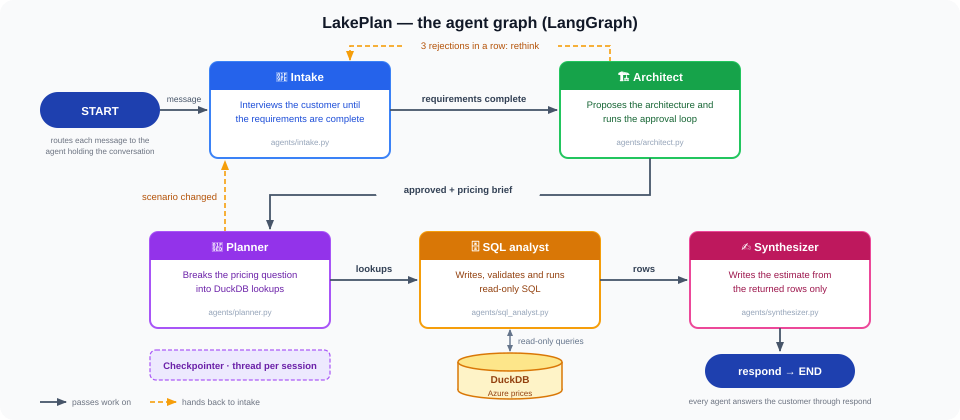
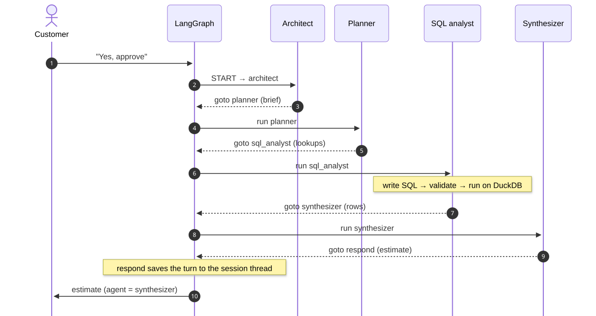
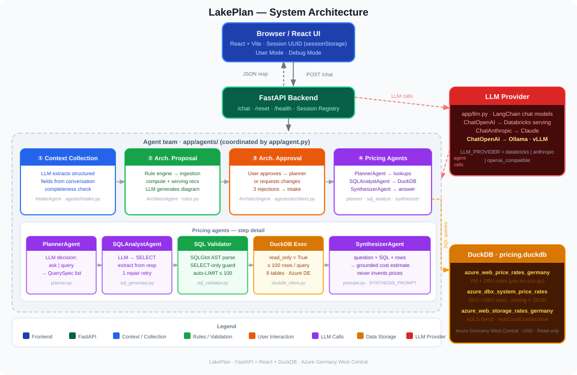

# LakePlan

[](https://github.com/issararab/LakePlan/actions/workflows/tests.yml)
[](https://github.com/issararab/LakePlan/actions/workflows/container-image.yml)
[](https://github.com/issararab/LakePlan/actions/workflows/helm.yml)
[](https://github.com/issararab/LakePlan/pkgs/container/lakeplan)
[](deploy/helm/lakeplan)


**A Databricks architecture planning and cost estimation agent.**

LakePlan proposes a Databricks solution architecture for your use case, then estimates what it will cost on Azure Germany West Central. Implemented as a FastAPI backend with a React + Vite frontend.

## What it does

The agent guides users through a structured flow:

1. **Path selection** — user picks one of 5 use-case paths (DWH Migration, Cloud Platform Migration, Real-Time, ML/GenAI, Custom)
2. **Context collection** — conversational Q&A to gather source type, data volume, latency, BI users, etc.
3. **Architecture proposal** — rule engine + LLM generates a Databricks solution architecture; user approves or requests changes
4. **Pricing** — a planner agent decides what to look up, a SQL analyst agent queries DuckDB, and a synthesizer agent writes a cost estimate grounded in real Azure Germany pricing data

Each step is its own agent, and the agents run as a LangGraph state graph, as described below.

## 🤝 How the agents work together

LakePlan runs each session as a **[LangGraph](https://langchain-ai.github.io/langgraph/) state graph with five agent nodes**. Each agent does one job with its own prompts and tools, then returns a LangGraph `Command`: either go to the next agent with the data it needs, or go to `respond`, which answers the customer and ends the turn.



| Agent node | Its job | Tools it uses | Routes to |
|---|---|---|---|
| 🧾 **Intake** | Interviews the customer until the requirements are complete | context-extraction LLM, completeness check | **Architect** |
| 🏗️ **Architect** | Proposes the architecture, adjusts it on request, and writes the pricing brief once it's approved | rule engine, architecture LLM, approval classifier | **Planner** on approval · **Intake** after 3 rejections in a row |
| 🧭 **Planner** | Breaks the pricing question into self-contained lookups, and handles follow-up questions | planning LLM | **SQL analyst** · **Intake** if the customer changes the scenario |
| 🗄️ **SQL analyst** | Writes SQL for each lookup, validates it, and runs it read-only | SQL LLM, SQLGlot validator, DuckDB | **Synthesizer** (or answers "no data" itself, so nothing gets invented) |
| ✍️ **Synthesizer** | Writes the estimate using only the rows it was handed | synthesis LLM | `respond` |

The graph is built in [`app/graph.py`](app/graph.py):

```python
builder = StateGraph(LakePlanState, context_schema=LakePlanContext)
builder.add_node("intake", intake)
builder.add_node("architect", architect)
builder.add_node("planner", planner)
builder.add_node("sql_analyst", sql_analyst)
builder.add_node("synthesizer", synthesizer)
builder.add_node("respond", respond)

builder.add_conditional_edges(START, route_turn, ["intake", "architect", "planner"])
builder.add_edge("respond", END)
graph = builder.compile(checkpointer=new_checkpointer())
```

Each agent declares where it can go in its return type, and LangGraph builds the edges from that. Here is the architect sending an approved design to the planner ([`app/agents/architect.py`](app/agents/architect.py)):

```python
def architect(state: LakePlanState, runtime: Runtime[LakePlanContext]) -> Command[Literal["planner", "intake", "respond"]]:
    ...
    return hand_off(state, "architect", "planner", "Architecture approved — pricing it",
                    context=context, question=pricing_brief(context), followup=False)
```

How the pieces fit:

- 🧵 **One thread per session.** The browser's session id is the LangGraph `thread_id`, and the checkpointer keeps each session's state (requirements, architecture, phase, history) between turns. It's an in-memory saver; a SQLite or Postgres saver would keep sessions across restarts and replicas.
- 🎤 **Whoever answers holds the conversation.** `respond` records the phase of the agent that answered, and the START edge sends the next message back to that agent. A follow-up after a price goes straight to the planner.
- 🔌 **Dependencies come through the runtime context.** Nodes get the LLM as `runtime.context.llm`, outside the checkpointed state, so the tests run the real graph with a scripted LLM.
- 🧾 **Every hand-off is logged with a reason**, and the **Agent steps** panel in Debug mode shows it (marked ⇄).
- 🛑 **Loops are cut off.** Each turn runs with `recursion_limit=10`; the longest real turn takes 5 steps.
- 🔭 **Tracing.** Set `LANGSMITH_TRACING=true` and `LANGSMITH_API_KEY`, and each turn appears in [LangSmith](https://smith.langchain.com/) as one `lakeplan-turn` trace with a span per agent node, tagged with the session id.

<details>
<summary><b>One turn, step by step:</b> the customer approves the architecture</summary>



The API response says which agent answered (`"agent": "synthesizer"`), and in Debug mode `debug_steps` lists each hand-off with its reason.

</details>

## Architecture



## 🐳 Run it with Docker

The image is public on GitHub Container Registry, so there's nothing to log in to. It's built for `linux/amd64` and `linux/arm64` (Apple silicon included).

```bash
docker run --rm -p 8000:8000 \
  -e DATABRICKS_HOST=https://your-workspace.azuredatabricks.net \
  -e DATABRICKS_TOKEN=<your_databricks_token> \
  ghcr.io/issararab/lakeplan:latest
```

Open http://localhost:8000. It calls the `databricks-claude-opus-4-7` serving endpoint in your workspace; add `-e DATABRICKS_LLM_ENDPOINT=<endpoint>` to use another one. To run it on the Anthropic API or on your own models instead, see [Run it on your own models](#-run-it-on-your-own-models).

| Tag | Points to |
|---|---|
| `latest` | The newest build of `main` |
| `sha-<commit>` | One exact commit. Pin this for repeatable deploys |
| `1.2.3`, `1.2` | Release tags (pushed from git tags `v1.2.3`) |

The container runs as a non-root user (UID 10001) and has a built-in health check. [`container-image.yml`](.github/workflows/container-image.yml) runs the test suite on every push to `main` and publishes the image only if it passes. Pull requests run the tests ([`tests.yml`](.github/workflows/tests.yml)) and build the image without publishing it.

## ☸️ Deploy on Kubernetes

The Helm chart in [`deploy/helm/lakeplan`](deploy/helm/lakeplan) runs the published image with production defaults:

- 🔒 non-root user, read-only root filesystem, all Linux capabilities dropped, `RuntimeDefault` seccomp
- 🩺 startup, readiness and liveness probes on `/health`
- 🔑 LLM credentials from a Secret (yours, or one the chart creates)
- 🔁 pods restart automatically when settings change (config checksums)
- 🧪 a `helm test` hook that checks the API and the web UI from inside the cluster

```bash
kubectl create namespace lakeplan
kubectl -n lakeplan create secret generic lakeplan-llm \
  --from-literal=DATABRICKS_TOKEN=<your_databricks_token>

helm install lakeplan deploy/helm/lakeplan -n lakeplan \
  --set existingSecret=lakeplan-llm \
  --set config.DATABRICKS_HOST=https://your-workspace.azuredatabricks.net
helm test lakeplan -n lakeplan

kubectl -n lakeplan port-forward svc/lakeplan 8000:80   # then open http://localhost:8000
```

<details>
<summary><b>Chart values</b></summary>

| Value | Default | What it does |
|---|---|---|
| `image.repository` | `ghcr.io/issararab/lakeplan` | |
| `image.tag` | `latest` | Pin a `sha-<commit>` tag for repeatable deploys |
| `config` | `{LOG_LEVEL: INFO}` | Plain environment variables (ConfigMap), e.g. `LLM_PROVIDER`, `DATABRICKS_HOST`, `DATABRICKS_LLM_ENDPOINT` |
| `existingSecret` | `""` | A Secret you manage. Every key becomes an environment variable |
| `secrets` | `{}` | Or let the chart create the Secret (fine for local testing) |
| `ingress.enabled` | `false` | Expose LakePlan through your ingress controller (`ingress.className`, `ingress.hosts`, `ingress.tls`) |
| `replicaCount` | `1` | Chat sessions live in memory, so extra replicas rely on `service.sessionAffinity: ClientIP` to keep each user on one pod |
| `resources` | 100m CPU / 256Mi requested, 1Gi limit | |

</details>

### 🧪 Try it locally on kind

[`deploy/kind/smoke-test.sh`](deploy/kind/smoke-test.sh) builds the image, loads it into a [kind](https://kind.sigs.k8s.io/) cluster, installs the chart and checks it. No LLM credentials needed.

```bash
deploy/kind/smoke-test.sh                    # needs docker, kind, kubectl and helm
DELETE_CLUSTER=1 deploy/kind/smoke-test.sh   # same, then delete the cluster
```

It checks that the rollout finishes, `helm test` passes, the pod runs as UID 10001 on a read-only filesystem, `/health`, the web UI and `/chat` input validation answer through a port-forward, and the pricing database loaded all six tables. [`helm.yml`](.github/workflows/helm.yml) runs `helm lint` and the same script on a fresh kind cluster for every pull request that touches the app, the Dockerfile or the chart.

---

## Local development setup

**Prerequisites:** Python 3.11+ and Node 18+ (required by Vite 5).

### 1. Install Python dependencies

```bash
pip install -r requirements.txt
```

### 2. Build the frontend

```bash
cd frontend
npm install
npm run build
cd ..
```

Compiled React app outputs to `app/static/`.

### 3. Configure environment

```bash
cp .env.example .env
# Edit .env and fill in credentials
```

### 4. Run

```bash
python -m uvicorn app.main:app --reload
```

Open http://localhost:8000

> **Note**: `--reload` auto-restarts on file changes, which clears all in-memory sessions. Start without `--reload` for stable testing sessions.

## 🦙 Run it on your own models

LakePlan isn't tied to a hosted LLM. Every call goes through a [LangChain](https://python.langchain.com/) chat model, so switching backends is one setting. Set `LLM_PROVIDER=openai_compatible` and it talks to any server that speaks the OpenAI Chat Completions API, so the whole agent can run on Llama, Qwen, Mistral or Gemma on your own machine or GPU box. No cloud account needed, and no prompt or customer detail leaves your network.

| `LLM_PROVIDER` | Backend | LangChain model | Settings |
|---|---|---|---|
| `databricks` *(default)* | Databricks model serving | `ChatOpenAI` | `DATABRICKS_HOST`, `DATABRICKS_TOKEN`, `DATABRICKS_LLM_ENDPOINT` |
| `anthropic` | Anthropic API | `ChatAnthropic` | `ANTHROPIC_API_KEY`, `ANTHROPIC_MODEL` |
| `openai_compatible` | Ollama · vLLM · LM Studio · llama.cpp · OpenAI | `ChatOpenAI` | `OPENAI_BASE_URL`, `OPENAI_MODEL`, `OPENAI_API_KEY` *(optional)* |

### ⚡ One command: LakePlan + Ollama in Docker Compose

```bash
docker compose -f compose.ollama.yaml up --build
```

This starts Ollama, downloads `qwen2.5:7b` (4.7 GB, first run only), then starts LakePlan on http://localhost:8000. To pick another model, set `LAKEPLAN_MODEL`, for example `LAKEPLAN_MODEL=llama3.1:8b docker compose -f compose.ollama.yaml up --build`. The model weights live in a Docker volume, not in the LakePlan image, so switching models doesn't rebuild anything. GPU users can uncomment the `deploy:` block in [`compose.ollama.yaml`](compose.ollama.yaml).

### 🖥️ Ollama installed on your machine

```bash
OLLAMA_CONTEXT_LENGTH=16384 ollama serve
ollama pull qwen2.5:7b
```

```dotenv
# .env
LLM_PROVIDER=openai_compatible
OPENAI_BASE_URL=http://localhost:11434/v1
OPENAI_MODEL=qwen2.5:7b
```

### 🚀 vLLM on a GPU server

```bash
vllm serve Qwen/Qwen2.5-7B-Instruct --port 8001 --max-model-len 32768
```

```dotenv
LLM_PROVIDER=openai_compatible
OPENAI_BASE_URL=http://<gpu-host>:8001/v1
OPENAI_MODEL=Qwen/Qwen2.5-7B-Instruct
```

vLLM listens on port 8001 here because LakePlan already uses 8000. If you start vLLM with `--api-key`, set the same value in `OPENAI_API_KEY`.

> [!IMPORTANT]
> **Give the model at least a 16k-token context window.** The SQL-generation prompt carries the whole pricing schema (about 4,400 tokens), and the final answer prompt can pass 10k. Ollama sizes its default window from GPU memory. In testing on a 4 GB GPU it cut that SQL prompt down to 2,050 tokens **without returning an error**, which shows up as wrong SQL or broken JSON. Set `OLLAMA_CONTEXT_LENGTH=16384` (Compose does this for you). On vLLM, use `--max-model-len`.

> [!TIP]
> LakePlan cleans up the usual quirks of local models before parsing a reply: the `<think>…</think>` block from reasoning models such as DeepSeek-R1 and Qwen3, `//` comments inside JSON, and a list where a single text field was expected.

### 🎯 Which model?

LakePlan asks the model for strict JSON plans and DuckDB SQL against a six-table schema, so model size matters more than in a plain chatbot. Measured with Ollama 0.40 on a laptop GPU:

| Model | Download | What happened |
|---|---|---|
| `qwen2.5:3b` | 1.9 GB | Full request flow works, but the SQL used columns that don't exist |
| `qwen2.5:7b` | 4.7 GB | 1 of 3 test lookups returned the right price. Good for trying LakePlan out |

For estimates you'll share, serve a larger model, for example Qwen 2.5 32B or Llama 3.3 70B on a vLLM GPU server.


## UI modes

**User mode** — clean chat with plain-language answers; no SQL, no table names, no confidence labels.

**Debug mode** — each response shows a collapsible step panel (context extraction, rules fired, LLM calls, SQL + raw data). Pricing output includes full retrieved data tables, confidence label, and missing data section.

Mode is selected on the onboarding screen as a toggle and locks for the session.

## 📚 Documentation

| Topic | Where |
|---|---|
| How the agents work together | [README: agents](#-how-the-agents-work-together) |
| System architecture | [README: architecture diagram](#architecture) |
| API reference | `http://localhost:8000/docs` while the app runs (interactive, generated by FastAPI). Request and response models are in [`app/schemas.py`](app/schemas.py) |
| LLM configuration | [README: run it on your own models](#-run-it-on-your-own-models) |
| Pricing database | [CLAUDE.md: DuckDB schema](CLAUDE.md#duckdb-schema--critical-gotchas) and [SQL safety rules](CLAUDE.md#sql-validator-rules-appsql_validatorpy) |
| Docker image, Kubernetes and CI | [README: Docker](#-run-it-with-docker), followed by the Kubernetes section |
| Contributor notes | [CLAUDE.md](CLAUDE.md) |
