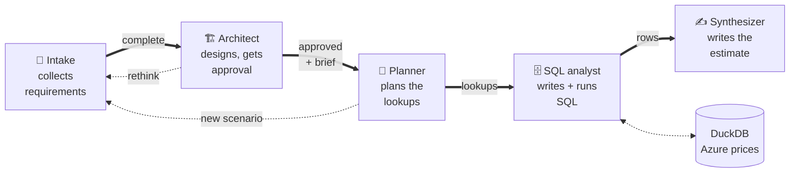
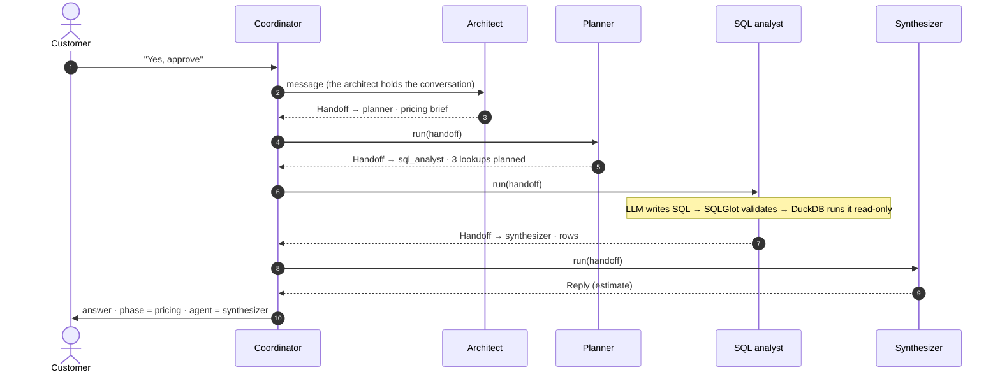

# LakePlan

**A Databricks architecture planning and cost estimation agent.**

LakePlan proposes a Databricks solution architecture for your use case, then estimates what it will cost on Azure Germany West Central. Implemented as a FastAPI backend with a React + Vite frontend.

## What it does

The agent guides users through a structured flow:

1. **Path selection** — user picks one of 5 use-case paths (DWH Migration, Cloud Platform Migration, Real-Time, ML/GenAI, Custom)
2. **Context collection** — conversational Q&A to gather source type, data volume, latency, BI users, etc.
3. **Architecture proposal** — rule engine + LLM generates a Databricks solution architecture; user approves or requests changes
4. **Pricing** — a planner agent decides what to look up, a SQL analyst agent queries DuckDB, and a synthesizer agent writes a cost estimate grounded in real Azure Germany pricing data

Each step is handled by its own agent, as described below.

## 🤝 How the agents work together

LakePlan runs each session with **a team of five agents**. Each agent does one job with its own prompts and tools, and ends its turn in one of two ways: it **replies** to the customer, or it **passes the work to a teammate** along with a reason and the data the teammate needs. The coordinator in [`app/agent.py`](app/agent.py) only routes; the agents decide who goes next.



| Agent | Its job | Tools it uses | Hands off to |
|---|---|---|---|
| 🧾 **Intake** | Interviews the customer until the requirements are complete | context-extraction LLM, completeness check | **Architect** |
| 🏗️ **Architect** | Proposes the architecture, adjusts it on request, and writes the pricing brief once it's approved | rule engine, architecture LLM, approval classifier | **Planner** on approval · **Intake** after 3 rejections in a row |
| 🧭 **Planner** | Breaks the pricing question into self-contained lookups, and handles follow-up questions | planning LLM | **SQL analyst** · **Intake** if the customer changes the scenario |
| 🗄️ **SQL analyst** | Writes SQL for each lookup, validates it, and runs it read-only | SQL LLM, SQLGlot validator, DuckDB | **Synthesizer** (or replies "no data", so nothing gets invented) |
| ✍️ **Synthesizer** | Writes the estimate using only the rows it was handed | synthesis LLM | replies to the customer |

**A handoff is a value, not a function call.** Here is the architect passing an approved design to the planner ([`app/agents/architect.py`](app/agents/architect.py)):

```python
return Handoff(
    to="planner",
    reason="Architecture approved — pricing it",
    payload={"question": pricing_brief(state.context), "followup": False},
)
```

The rules the team follows:

- 🎤 **Whoever replies holds the conversation.** The customer's next message goes to the agent that last answered, so a follow-up after a price goes to the planner, not back through intake.
- 🧾 **Nothing moves silently.** Every `Handoff` carries a reason, which goes to the logs and to the **Agent steps** panel in Debug mode (marked ⇄).
- 🧠 **Agents are stateless.** Session state lives in one `Session` object owned by the coordinator in `app/agent.py`, so any agent can be tested on its own.
- 🛑 **Loops are cut off.** A turn stops after 5 passes between agents. The longest real chain is 3.

<details>
<summary><b>One turn, step by step:</b> the customer approves the architecture</summary>



The API response says which agent answered (`"agent": "synthesizer"`), and in Debug mode `debug_steps` lists each `Handoff` with its reason.

</details>

## Architecture


## Running with Docker (recommended)

The easiest way to run the agent — no Python or npm required.

### Prerequisites

- [Docker Desktop](https://www.docker.com/products/docker-desktop/) installed and running
- A Databricks personal access token

### Pull and run

**Step 1 — Authenticate with GitHub Container Registry**

You need a GitHub personal access token with `read:packages` scope:
1. Go to **GitHub → Settings → Developer settings → Personal access tokens → Tokens (classic)**
2. Generate new token → check **`read:packages`** and **`repo`**
3. Copy the token and login:

```bash
echo YOUR_GITHUB_TOKEN | docker login ghcr.io -u YOUR_GITHUB_USERNAME --password-stdin
```

**Step 2 — Pull and run**

```bash
docker pull ghcr.io/ruhragency/databricks-pricing-agent:latest
```

**Option A** — use pre-configured workspace and model:

```bash
docker run -p 8000:8000 \
  -e DATABRICKS_TOKEN=<your_databricks_token> \
  ghcr.io/ruhragency/databricks-pricing-agent:latest
```

**Option B** — override the workspace or model:

```bash
docker run -p 8000:8000 \
  -e DATABRICKS_TOKEN=<your_databricks_token> \
  -e DATABRICKS_HOST=https://your-workspace.azuredatabricks.net \
  -e DATABRICKS_LLM_ENDPOINT=your-model-endpoint \
  ghcr.io/ruhragency/databricks-pricing-agent:latest
```

Open http://localhost:8000

### Stop the container

```bash
docker ps                          # find the container ID
docker stop <container_id>
```

---

## Local development setup

**Prerequisites:** Python 3.11+ and Node 18+ (required by Vite 5).

### 1. Install Python dependencies

```bash
pip install -r requirements.txt
```

### 2. Build the frontend

```bash
cd frontend
npm install
npm run build
cd ..
```

Compiled React app outputs to `app/static/`.

### 3. Configure environment

```bash
cp .env.example .env
# Edit .env and fill in credentials
```

### 4. Run

```bash
python -m uvicorn app.main:app --reload
```

Open http://localhost:8000

> **Note**: `--reload` auto-restarts on file changes, which clears all in-memory sessions. Start without `--reload` for stable testing sessions.


## UI modes

**User mode** — clean chat with plain-language answers; no SQL, no table names, no confidence labels.

**Debug mode** — each response shows a collapsible step panel (context extraction, rules fired, LLM calls, SQL + raw data). Pricing output includes full retrieved data tables, confidence label, and missing data section.

Mode is selected on the onboarding screen as a toggle and locks for the session.

## Documentation

- [How It Works & Project Structure](../../wiki/How-It-Works)
- [API Reference](../../wiki/API-Reference)
- [LLM Configuration](../../wiki/LLM-Configuration)
- [Pricing Database](../../wiki/Pricing-Database)
- [Building and Publishing the Docker Image](../../wiki/Building-and-Publishing-Docker-Image)
