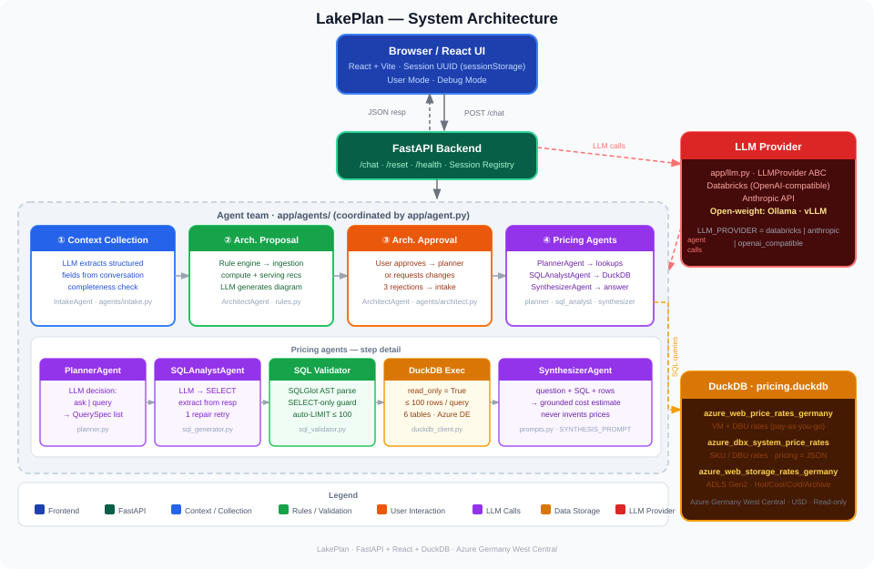

# LakePlan

[](https://github.com/issararab/LakePlan/actions/workflows/container-image.yml)
[](https://github.com/issararab/LakePlan/actions/workflows/helm.yml)
[](https://github.com/issararab/LakePlan/pkgs/container/lakeplan)
[](deploy/helm/lakeplan)


**A Databricks architecture planning and cost estimation agent.**

LakePlan proposes a Databricks solution architecture for your use case, then estimates what it will cost on Azure Germany West Central. Implemented as a FastAPI backend with a React + Vite frontend.

## What it does

The agent guides users through a structured flow:

1. **Path selection** — user picks one of 5 use-case paths (DWH Migration, Cloud Platform Migration, Real-Time, ML/GenAI, Custom)
2. **Context collection** — conversational Q&A to gather source type, data volume, latency, BI users, etc.
3. **Architecture proposal** — rule engine + LLM generates a Databricks solution architecture; user approves or requests changes
4. **Pricing** — planner decides what to query, SQL generator queries DuckDB, LLM synthesises a cost estimate grounded in real Azure Germany pricing data

## Architecture



## 🐳 Run it with Docker

The image is public on GitHub Container Registry, so there's nothing to log in to. It's built for `linux/amd64` and `linux/arm64` (Apple silicon included).

```bash
docker run --rm -p 8000:8000 \
  -e DATABRICKS_TOKEN=<your_databricks_token> \
  ghcr.io/issararab/lakeplan:latest
```

Open http://localhost:8000. To use your own workspace or model endpoint:

```bash
docker run --rm -p 8000:8000 \
  -e DATABRICKS_TOKEN=<your_databricks_token> \
  -e DATABRICKS_HOST=https://your-workspace.azuredatabricks.net \
  -e DATABRICKS_LLM_ENDPOINT=your-model-endpoint \
  ghcr.io/issararab/lakeplan:latest
```

| Tag | Points to |
|---|---|
| `latest` | The newest build of `main` |
| `sha-<commit>` | One exact commit. Pin this for repeatable deploys |
| `1.2.3`, `1.2` | Release tags (pushed from git tags `v1.2.3`) |

The container runs as a non-root user (UID 10001) and has a built-in health check. [`container-image.yml`](.github/workflows/container-image.yml) rebuilds and publishes it on every push to `main`, and builds it (without publishing) on pull requests.

## ☸️ Deploy on Kubernetes

The Helm chart in [`deploy/helm/lakeplan`](deploy/helm/lakeplan) runs the published image with production defaults:

- 🔒 non-root user, read-only root filesystem, all Linux capabilities dropped, `RuntimeDefault` seccomp
- 🩺 startup, readiness and liveness probes on `/health`
- 🔑 LLM credentials from a Secret (yours, or one the chart creates)
- 🔁 pods restart automatically when settings change (config checksums)
- 🧪 a `helm test` hook that checks the API and the web UI from inside the cluster

```bash
kubectl create namespace lakeplan
kubectl -n lakeplan create secret generic lakeplan-llm \
  --from-literal=DATABRICKS_TOKEN=<your_databricks_token>

helm install lakeplan deploy/helm/lakeplan -n lakeplan --set existingSecret=lakeplan-llm
helm test lakeplan -n lakeplan

kubectl -n lakeplan port-forward svc/lakeplan 8000:80   # then open http://localhost:8000
```

<details>
<summary><b>Chart values</b></summary>

| Value | Default | What it does |
|---|---|---|
| `image.repository` | `ghcr.io/issararab/lakeplan` | |
| `image.tag` | `latest` | Pin a `sha-<commit>` tag for repeatable deploys |
| `config` | `{LOG_LEVEL: INFO}` | Plain environment variables (ConfigMap), e.g. `LLM_PROVIDER`, `DATABRICKS_HOST`, `DATABRICKS_LLM_ENDPOINT` |
| `existingSecret` | `""` | A Secret you manage. Every key becomes an environment variable |
| `secrets` | `{}` | Or let the chart create the Secret (fine for local testing) |
| `ingress.enabled` | `false` | Expose LakePlan through your ingress controller (`ingress.className`, `ingress.hosts`, `ingress.tls`) |
| `replicaCount` | `1` | Chat sessions live in memory, so extra replicas rely on `service.sessionAffinity: ClientIP` to keep each user on one pod |
| `resources` | 100m CPU / 256Mi requested, 1Gi limit | |

</details>

### 🧪 Try it locally on kind

[`deploy/kind/smoke-test.sh`](deploy/kind/smoke-test.sh) builds the image, loads it into a [kind](https://kind.sigs.k8s.io/) cluster, installs the chart and checks it. No LLM credentials needed.

```bash
deploy/kind/smoke-test.sh                    # needs docker, kind, kubectl and helm
DELETE_CLUSTER=1 deploy/kind/smoke-test.sh   # same, then delete the cluster
```

It checks that the rollout finishes, `helm test` passes, the pod runs as UID 10001 on a read-only filesystem, `/health`, the web UI and `/chat` input validation answer through a port-forward, and the pricing database loaded all six tables. [`helm.yml`](.github/workflows/helm.yml) runs `helm lint` and the same script on a fresh kind cluster for every pull request that touches the app, the Dockerfile or the chart.

---

## Local development setup

**Prerequisites:** Python 3.11+ and Node 18+ (required by Vite 5).

### 1. Install Python dependencies

```bash
pip install -r requirements.txt
```

### 2. Build the frontend

```bash
cd frontend
npm install
npm run build
cd ..
```

Compiled React app outputs to `app/static/`.

### 3. Configure environment

```bash
cp .env.example .env
# Edit .env and fill in credentials
```

### 4. Run

```bash
python -m uvicorn app.main:app --reload
```

Open http://localhost:8000

> **Note**: `--reload` auto-restarts on file changes, which clears all in-memory sessions. Start without `--reload` for stable testing sessions.


## UI modes

**User mode** — clean chat with plain-language answers; no SQL, no table names, no confidence labels.

**Debug mode** — each response shows a collapsible step panel (context extraction, rules fired, LLM calls, SQL + raw data). Pricing output includes full retrieved data tables, confidence label, and missing data section.

Mode is selected on the onboarding screen as a toggle and locks for the session.

## Documentation

- [How It Works & Project Structure](../../wiki/How-It-Works)
- [API Reference](../../wiki/API-Reference)
- [LLM Configuration](../../wiki/LLM-Configuration)
- [Pricing Database](../../wiki/Pricing-Database)
- [Building and Publishing the Docker Image](../../wiki/Building-and-Publishing-Docker-Image)
